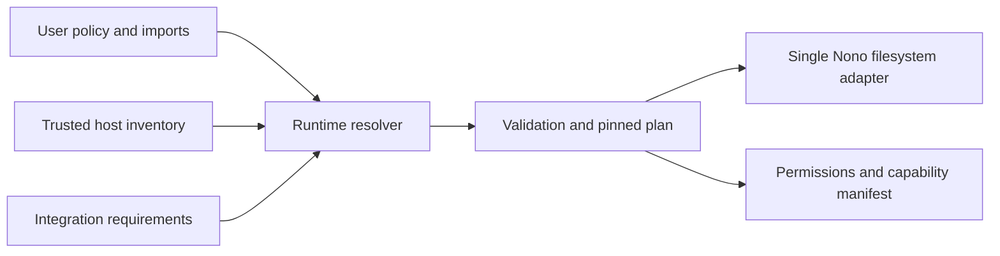

# Development and releases

## Build from source

Nonaut requires Rust 1.99.1.

```sh
git clone git@github.com:nolabs-ai/nonaut.git
cd nonaut
make run
```

The default build includes every provider and excludes enrollment and audit
shipping. Include the optional control-plane crate with:

```sh
cargo build --features control-plane
```

### Select providers

Official release binaries include all providers. Source builds can exclude the
default set and enable only the required providers:

```sh
cargo build --release --no-default-features \
  --features provider-codex,provider-gemini
```

Available provider features are:

- `provider-codex`
- `provider-claude`
- `provider-gemini`
- `provider-copilot`
- `provider-openrouter`
- `provider-ollama`
- `provider-openai-compatible`

Features compose normally. For example, a selective build can also include
the control plane:

```sh
cargo build --release --no-default-features \
  --features provider-claude,provider-copilot,control-plane
```

To build a release tag, check out that tag before running the same command.
Only compiled providers appear in the provider picker, and dependencies used
solely by omitted providers are not built.

## Development commands

| Command | Action |
| --- | --- |
| `make ci` | Run exhaustive all-feature checks, integration tests, and smoke build |
| `make run` | Build an optimized binary and launch Nonaut |
| `make build` | Build the debug binary for local development |
| `make release-build` | Build the optimized release binary |
| `make check` | Run the fast default-feature formatting, lint, and unit checks |
| `make integration` | Run provider-free sandbox and TUI integration tests |
| `make smoke` | Exercise the release binary through `nonaut exec` |
| `make fmt` | Format the Rust workspace |
| `make lint` | Run Clippy with warnings denied |
| `make test` | Run the Rust test suite |
| `make clean` | Remove Cargo build artifacts |

Run `make ci` before opening a pull request. Integration tests do not connect
to a provider or consume model tokens.

`make check` avoids rebuilding the same default provider graph for a second
all-features pass during normal iteration. `make ci` retains both configurations
so feature-gating mistakes are still caught before merging.

## Extending runtime support

During the MVP, update configuration and manifest shapes directly. Do not add
internal schema versions, migration paths or compatibility branches.

The runtime engine lives in `src/runtime`. Each integration module owns one
`DEFINITION`: its identifier, category, project markers, host detector, optional
fixed program/argument probe, and requirement resolver. Register it in `integrations::CATALOG`.
Resolvers return typed requirements without creating directories or executing
repository code. They cannot change network policy or model file-tool access.



Keep discovery within known installation roots or trusted host settings. Declare
read-only toolchain paths separately from private writable state. The resolver
handles auto/manual/custom selection, exclusions, environment overrides and
origins. Policy validation checks writable installation/protected-path conflicts
and Linux deny overlaps before private state is prepared. `sandbox::apply_filesystem`
checks canonical bindings and applies the plan without synthesizing grants.

Add fixture tests for detection, custom locations, exclusions and custom mode;
add provider-free integration coverage for actual execution and denied access.
Run `make ci` on macOS and Linux. Changes to runtime behavior should also exercise
`nonaut runtime check` and an offline native build on both platforms.

## Install from main

Build and install the current `main` branch with:

```sh
curl -fsSL https://raw.githubusercontent.com/nolabs-ai/nonaut/main/install.sh | sh -s -- --from-main
```

Add `--control-plane` to build and install that flavor from main.

This requires Cargo. Running it again downloads and rebuilds the latest main
branch. The regular installer can replace a main build with a release, and
`--from-main` can replace a release with a development build.

## Releases

Push a version tag matching `Cargo.toml`, such as `v0.0.3`, to publish release
binaries, checksums, and signed build provenance for supported Linux and macOS
targets.
